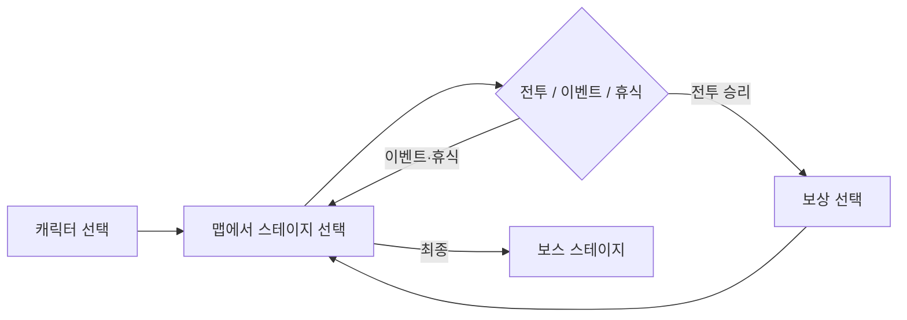

# Dungeon Explorer

그리드 이동 기반의 3D 팀 턴제 로그라이크 RPG

[▶ 게임 플레이 영상 (YouTube)](https://youtu.be/eCGahCjy9DI)

<!-- 대표 이미지: images/hero.png -->

---

## 1. 프로젝트 소개

스테이지를 클리어해 얻은 보상으로 파티를 강화하고, 강한 보스가 기다리는 최종 스테이지를 클리어하는 게임입니다.
새 게임을 시작할 때마다 캐릭터의 능력이 초기화되고 맵의 구조도 새로 만들어집니다.

- **영감을 받은 게임:** 슬레이 더 스파이어(스테이지 구성, 무작위 맵 구조), 발더스 게이트(턴제 전투, 여러 직업의 협동), 엑스컴(그리드 이동)
- **개발 방식:** 그리드·경로 탐색·턴 시스템·적 AI 등 핵심 시스템을 직접 설계하고 구현했습니다. AI 도구는 보조로만 제한적으로 사용했습니다(MCP 등 에디터 연동 도구는 사용하지 않음).
- **후속 프로젝트:** 같은 기획을 AI 에이전트 중심으로 다시 만든 [Dungeon4Player](https://github.com/hello13580/Dungeon4Player-portfolio)에서 두 방식을 비교했습니다.

| 항목 | 내용 |
|---|---|
| 장르 | 3D 그리드 턴제 로그라이크 RPG (싱글) |
| 개발 인원 | 1인 |
| 개발 기간 | 2026.05 ~ 2026.07 (약 3개월) |
| 엔진 | Unity 6000.3.15f1 |
| 언어 | C# |
| 규모 | C# 스크립트 164개 (약 2.1만 줄), 행동(스킬) 40여 종 |

## 2. 게임 진행



1. **캐릭터 선택:** 게임 시작 시 1회, 전사·마법사·클레릭·궁수 중에서 파티를 꾸립니다.
2. **스테이지 선택:** 자동 생성된 맵에서 다음 스테이지를 고릅니다(일반·엘리트·보스 전투, 휴식, 이벤트).
3. **전투:** 맵의 모든 적을 제거하면 승리합니다.
4. **보상:** 승리하면 캐릭터마다 1회, 직업별 목록에서 무작위로 제시된 보상(스킬 습득, 능력치 강화)을 고릅니다. 건너뛸 수도 있습니다.

<!-- 스크린샷: images/reward.png, images/map.png -->

## 3. 전투

### 전투 자원

| 자원 | 회복 | 설계 의도 |
|---|---|---|
| 행동 포인트 | 매 턴 최대치 회복 | 한 턴에 할 수 있는 행동 수 |
| 마나 | 매 턴 최대치의 약 20% 회복 | 강한 스킬을 위해 모을지, 바로 쓸지 선택하게 함 |
| 직업 포인트 | 스테이지 시작 시 1회만 회복 | 체력 회복처럼 전투를 끝없이 늘릴 수 있는(스톨링) 스킬의 스테이지당 사용 횟수를 제한 |

### 스킬 사용 UI

- 스킬을 고르면 범위를 미리 표시하고, 목표 칸을 클릭하면 바로 시전합니다.
- 스킬 버튼 위에서 **T키**를 누르면 상세 설명과 소모 자원을 보여 줍니다.
- 유닛 상태창에서 선택한 유닛의 버프·디버프를 확인할 수 있습니다.

<!-- 스크린샷: images/skill_ui.png -->

## 4. 기술 포인트

### 4.1 그리드 시스템 (3계층)

이동 거리와 스킬 범위를 플레이어가 칸 단위로 직관적으로 계산할 수 있도록 그리드 기반 맵을 택했습니다.

```
LevelGrid      외부 클래스가 그리드에 접근하는 유일한 창구 (싱글톤)
 └ GridSystem  층 단위의 N×M 그리드 데이터
    └ GridObject  칸 하나의 위치(GridPosition), 유닛, 장애물 정보
```

- 외부 시스템은 `LevelGrid`만 알면 되고, 층이 늘어나도 `GridSystem`만 추가하면 되어 **여러 층 맵**으로 쉽게 확장할 수 있습니다.
- 층 사이는 계단 칸을 경로 탐색 링크(`PathFindingLink`)로 이어 이동합니다.
- 유닛마다 크기(`size`)가 있어 여러 칸을 차지하는 큰 유닛도 같은 경로 탐색을 씁니다.

### 4.2 경로 탐색 최적화 (A*)

| 문제 | 해결 |
|---|---|
| 탐색할 때마다 모든 노드의 G/H/F 값을 초기화해 O(N) 비용 발생 | 노드에 `LastSearchId`를 두고, 현재 탐색 번호와 다른 노드만 **사용하는 시점에** 초기화 |
| 적 AI가 모든 이동 후보 × 모든 플레이어에 대해 A*를 돌려 O(N×M)까지 증가 | 직선 거리가 가장 가까운 플레이어를 먼저 목표로 정하고, 그 플레이어에 대해서만 A* 수행 |

- 열린 목록은 직접 만든 이진 힙(`Heap<T>`)으로 관리합니다.
- 직선 거리는 **목표 선택에만** 쓰고 실제 이동 거리는 A*로 계산해, 계단·장애물이 있어도 정확한 경로를 유지합니다.

### 4.3 이동 가능 범위 계산 (다익스트라 플러드 필)

- **문제:** 이동 범위를 표시할 때 범위 안 모든 칸마다 A*를 따로 실행해, 이동력이 늘수록 연산량이 급격히 늘고 눈에 띄는 렉이 생겼습니다.
- **원인:** 목적지가 하나일 때 쓰는 A*를 "도달 가능한 모든 칸 찾기"에 반복해서 썼습니다.
- **해결:** 현재 위치에서 가까운 칸부터 이동 비용을 더해 가며 넓혀 나가고, 이동력을 넘는 칸에서 멈추는 방식(다익스트라 플러드 필, `GetReachableGridPositions`)으로 바꿨습니다.
- **결과:** A* 수백 회 → 탐색 1회로 줄어 렉이 사라졌습니다.

### 4.4 턴 시스템 (행동 게이지)

**목표:** 속도가 n배인 유닛은 n배 더 많이 행동하고, 속도 변화가 바로 반영되는 턴 순서.

| 검토한 방식 | 내용 |
|---|---|
| 속도순 정렬 | 유닛을 속도 내림차순으로 정렬하고, 각 유닛의 턴마다 다시 정렬 |
| 우선순위 큐 | 각 유닛의 다음 턴을 기준값 / 속도로 계산해 우선순위 큐에 넣음 |
| **행동 게이지 (채택)** | 게이지가 속도에 비례해 차오르고, 기준값에 닿은 유닛이 바로 행동 |

- **채택 이유:** 속도 변화를 바로 반영하면서, 속도에 비례한 행동 횟수를 보장합니다.

- 행동 뒤 게이지를 0으로 만들지 않고 **기준값만 빼서** 남은 값을 이월합니다. 그래서 행동 횟수가 정확하게 속도에 비례합니다.
- **검증:** 속도 5 / 10 / 10 / 15 유닛을 100턴 돌려 로그로 측정 → **12 / 25 / 25 / 38회** (기대값 12.5 / 25 / 25 / 37.5).

### 4.5 스킬 구조

- **공통 로직 통합:** 모든 행동은 `BaseAction`을 상속해 이름, 소모 자원, 범위 계산 등을 공유합니다. 이동·공격·장판·버프·순간이동 등 40여 종을 이 구조로 만들었습니다.
- **같은 종류는 인터페이스로:** 상호작용(`IInteractable`), 오라(`IAuraAction`)처럼 같은 종류의 행동은 인터페이스로 묶어, 새 행동을 쉽고 안전하게 추가할 수 있습니다.
- **습득 방식:** 배울 수 있는 스킬 컴포넌트를 비활성 상태로 미리 붙여 두고, 배우면 켭니다. 수치와 이펙트는 인스펙터에서 미리 설정해 두므로 습득 처리는 컴포넌트 활성화만으로 끝납니다.

### 4.6 적 AI (행동 점수)


- 각 행동이 `GetEnemyAIAction`으로 현재 위치에서 가능한 목표마다 점수(`actionValue`)를 매기고, `EnemyTurnManager`가 행동별 최고 점수를 비교해 가장 높은 행동을 실행합니다.
- 목표 기준은 행동마다 다릅니다(예: `BowAction`은 남은 체력이 가장 낮은 대상을 우선).
- **장점:** 점수 계산을 각 행동에 맡겨, 새 스킬을 추가해도 `EnemyTurnManager`를 고치지 않고 적이 바로 쓸 수 있습니다. 플레이어와 적이 **같은 행동 스크립트**를 씁니다.

### 4.7 데이터 분리와 저장

- **맵 자동 생성:** 맵 생성용 ScriptableObject에 스테이지 종류(일반·엘리트·보스 전투, 휴식, 이벤트)별 개수를 넣으면 맵이 만들어집니다.
- **단계별 등장 제한:** 진행 단계(레이어)마다 나올 수 있는 스테이지를 정해, 초반에 너무 어려운 스테이지가 나오지 않게 했습니다.
- **스테이지 데이터:** 등장 유닛의 종류·수·위치를 스테이지마다 데이터로 설정합니다. 밸런스와 맵 구성을 코드 수정 없이 조정할 수 있습니다.
- **낮은 결합도:** 유닛 사망·턴 변경 같은 상태 변화는 이벤트로 알려, 시스템끼리 직접 참조하지 않게 했습니다(전역 매니저는 싱글톤으로 접근).
- **저장·불러오기:** 진행 데이터를 JSON으로 직렬화해 로컬에 저장합니다.

<!-- 스크린샷: images/map_config.png (맵 생성 ScriptableObject 인스펙터) -->

## 5. 프로젝트 구조

```
Assets/Scripts
├─ Actions       행동(스킬) 40여 종, BaseAction
├─ Grid          LevelGrid · GridSystem · GridObject, 칸 표시
├─ PathFinding   A*, 힙, 계단 링크, 이동 범위(다익스트라)
├─ Unit          유닛, 행동 선택, 애니메이션, 직업 포인트
├─ System        턴, 적 턴(AI), 체력·마나·상태 효과·버프
├─ Skills        캐릭터·스킬 데이터, 스킬 습득
├─ Map / Stage   맵 자동 생성, 스테이지 데이터
├─ Objects       투사체, 장판, 문, 상호작용 물체
├─ Save          JSON 저장·불러오기
├─ Camera        카메라 조작, 행동 카메라, 화면 흔들림
├─ UI            전투·맵·보상·스킬 설명 UI
└─ Visual        오라·장판·검 궤적 연출
```

